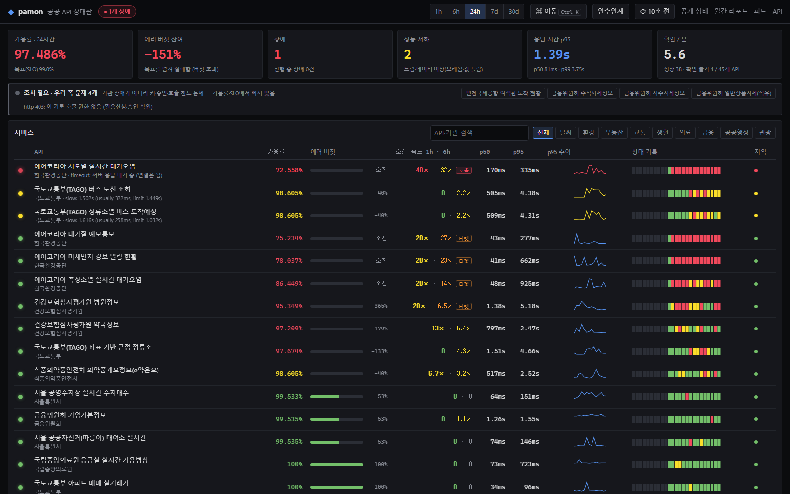
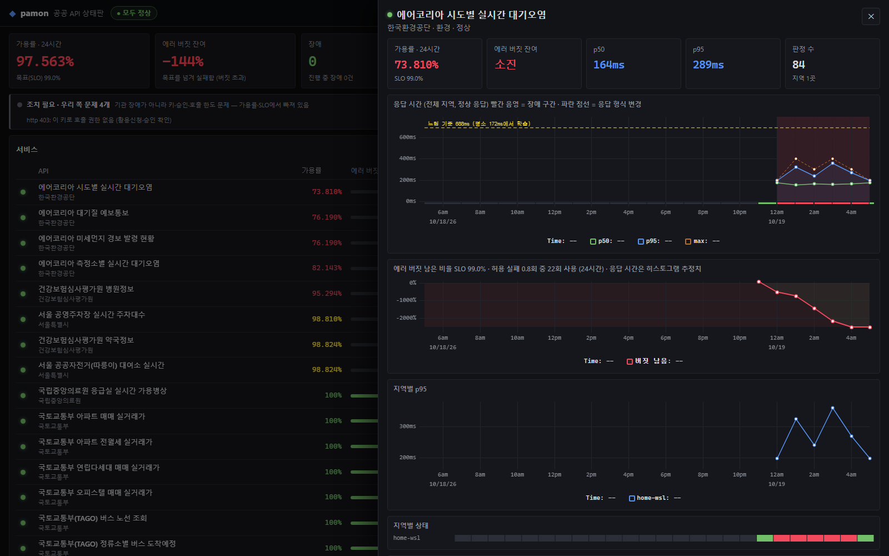
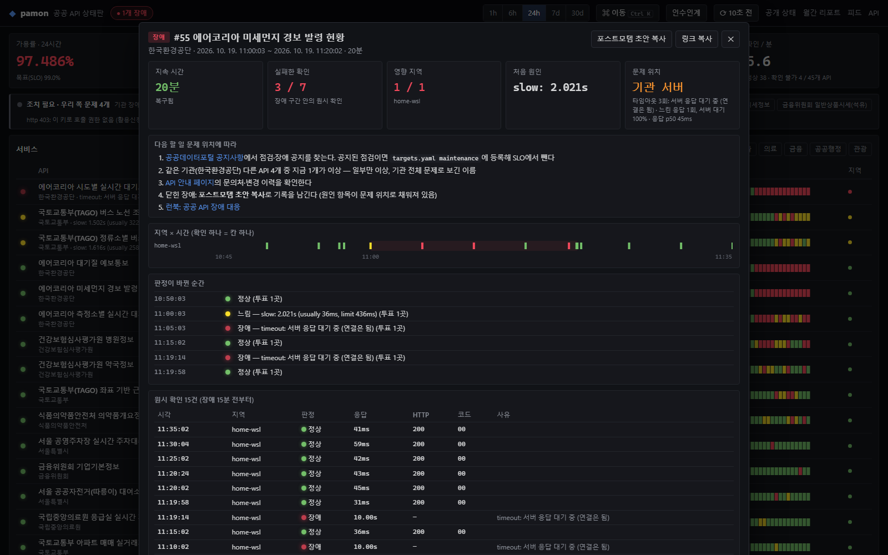

# pamon: 개발자가 의존하는 외부 서비스 상태판

### 👉 **https://pamon.hyunsuhahaha.workers.dev/**

AI에게 장애 진단을 맡길 때: **https://pamon.hyunsuhahaha.workers.dev/llms.txt** 를 읽고 오류 시각·호스트와 비교하라고 하세요.

접속 기록: 아래 주소들은 [로그 입구](deploy/access/README.md)(Cloudflare Worker)를 거쳐 사람·AI의 HTML/JSON 요청을 D1에 남기고 비공개 관리자 화면에서 조회합니다. User-Agent 기준 추정입니다.

## AI 장애 진단에 사용하기

AI가 사용자 로그와 외부 관측을 비교할 수 있도록 공개 읽기 전용 데이터를 제공합니다. 시작 주소: **https://pamon.hyunsuhahaha.workers.dev/llms.txt**

- `llms.txt`: 조회 안내와 해석 규칙
- `ai/index.html`: 필드 설명·AI 요청 예시
- `ai/diagnostics.json`: 서비스명·공급자·호스트로 찾는 전체 카탈로그
- `ai/targets/{id}.json`: 대상 하나의 관측 상태·위치·최근 장애·근거 링크

AI에 [`ai/index.html`](https://pamon.hyunsuhahaha.workers.dev/ai/index.html) 링크를 전달하고 오류 시각·호스트·기능을 비교하도록 요청하세요. JSON 링크는 해당 JSON URL 기준으로 해석합니다. `freshUntil`을 현재 시각과 비교해야 하며 `freshAtGeneration`만으로 최신성을 판단하면 안 됩니다. 감시용 인증·쿼터 문제는 공급자 장애와 구분합니다. MCP 서버나 모든 AI의 자동 발견 기능은 포함하지 않습니다.

### 👉 [실시간 상태판 열기](https://pamon.hyunsuhahaha.workers.dev/)

[](https://pamon.hyunsuhahaha.workers.dev/s/) [](https://github.com/hyunsuhahaha/public-api-monitor/actions/workflows/ci.yml) [](https://github.com/hyunsuhahaha/public-api-monitor/actions/workflows/watchdog.yml)

공공데이터포털(data.go.kr)과 서울 열린데이터광장의 **공공 API 77개**, **카카오맵·네이버 Maps 4개 기능**, **npm·PyPI·Docker Hub·GitHub 8개 기능**, 그리고 사람과 개발자가 막히는 **로그인·정부·은행·결제·AI·클라우드·메신저·SaaS 등 71개**까지 **160개**가 지금 동작하는지, 느린지, 잘못된 결과를 주는지 5분마다 확인합니다. 인증이 필요한 API는 자격 없이 불러 **그 서비스 자신의 거절 응답**(예: 401과 자체 오류 형식)이 오는지로 확인하고, 페이지는 정상 화면의 문구가 있는지까지 봅니다(점검·차단 페이지를 정상으로 착각하지 않음). 분야 목록과 방법은 [분야별 감시 대상과 키 없는 확인](#분야별-감시-대상과-키-없는-확인)에 있습니다. 결과는 SLO와 에러 버짓, 장애 기록으로 보여줍니다.

**서비스별 답 페이지** [`/s/`](https://pamon.hyunsuhahaha.workers.dev/s/): "OO 지금 되나요?"에 한 줄 결론, 나만 그런지에 대한 안내, 마지막 요청이 DNS·연결·TLS·서버 대기 중 어디서 시간을 썼는지, 제공사 공식 상태 발표와의 비교(GitHub·Slack·OpenAI·Anthropic·Cloudflare 등 24곳), 최근 장애, 이 API에 의존하는 개발자가 할 일(결제는 멱등성 키와 백오프 재시도, 로그인은 세션 유지, 공공 데이터는 마지막 정상 데이터 캐시, 메시지는 큐, AI는 예비 모델), "나도 안 돼요" 제보 수를 보여줍니다. 서버에서 그린 HTML이라 검색엔진과 AI가 그대로 읽습니다.



*실제 운영 화면(2026-10-19 오후).*
- **조치 필요 배너:** 승인 대기로 403이 나는 API 4개를 우리 쪽 문제로 묶어 보여준다.
- **소진 속도 열:** 에어코리아 API들이 에러 버짓을 태우는 속도(burn rate)를 보여준다. 1시간과 5분 창을 함께 넘은 API에만 '호출' 태그가, 6시간과 30분 창을 함께 넘은 API에만 '티켓' 태그가 붙는다.



*API 상세 화면 (에어코리아 미세먼지 경보).*
- **타임아웃 재확인:** 맨 위 줄이 결과를 보여준다. 이 API에서는 타임아웃 직후 다시 보낸 요청이 141ms 만에 응답했다(재시도로 바로 됨 3, 늦게 응답 1).
- **응답 시간 차트:** 학습한 '느림' 기준선(평소 37ms → 437ms)과 고정 기준(slow_after 3s)을 함께 그리고, 장애 구간은 붉게 칠한다.
- **에러 버짓:** 바닥난 시각을 표시한다.
- **시간이 쓰인 곳:** 응답 시간의 100%가 기관 서버 대기다.



*장애 상세 화면.*
- **문제 위치:** 기관 서버로 판정하고, 근거(타임아웃 3회 모두 서버 응답 대기에서 멈춤)를 함께 보여준다.
- **다음 할 일:** 공지 확인, 같은 기관의 다른 API 상태, 문의처, 런북 순서로 안내한다.
- **원시 기록:** 지역 × 시간 표, 판정이 바뀐 순간, 원시 확인 기록이 이어진다.
- **포스트모템 초안 복사:** 이 내용으로 원인 항목이 채워진 초안을 만든다.

## 한눈에

| | |
|---|---|
| **감시 대상** | 공공 API 77개 + 지도 4개 기능 + 개발·배포 의존성 8개 기능 + 로그인·은행·결제·AI·클라우드 등 71개 (총 160개, 26개 분야) |
| **핵심 문제** | 공공 API는 실패해도 HTTP 200을 준다. 본문의 결과 코드까지 읽어 판정한다 |
| **판정** | 6단계(정상·느림·데이터 이상·오류·장애·확인 불가), API별로 학습한 평소 속도 기준의 "느림", 미국·한국 지점별 결과(한국 서비스는 한국 기준, 나머지는 한 곳이라도 실패하면 장애) |
| **SRE** | API별 SLO와 에러 버짓, 모니터 자체 SLO와 burn-rate 알림, 게임데이(장애 주입 훈련), 포스트모템, 런북 |
| **관측성** | Prometheus 지표, OpenTelemetry 트레이스(확인 1건 = 트레이스 1개: 대기 → HTTP 호출 → 판정, 로그에 trace_id), 구조화 로그 |
| **인프라** | Go 단일 바이너리, SQLite + Litestream(GCS), GCP e2-micro, Cloudflare Workers·D1, Secret Manager, Prometheus·Grafana·Jaeger, Terraform(OCI), Ansible, 멀티 아키텍처 이미지, GitHub Actions(CI·외부 감시) |
| **운영 중 잡은 것** | 에어코리아 API 타임아웃은 우리 네트워크가 아니라 기관 서버 쪽: 대부분은 일부 요청만 걸려 재시도하면 바로 되고, 가끔 기관 전체가 30~57초씩 느려짐. 출근 시간대 버스 API 지연, 내 모니터의 오탐 3종 (아래) |

## 분야별 감시 대상과 키 없는 확인

| 분야 | 개수 | 제공자 |
|---|---|---|
| 로그인·인증 | 5 | 카카오, 네이버, Google, Apple |
| 은행·결제 | 7 | KB국민은행, 신한은행, 토스뱅크, 카카오페이, Stripe, PayPal, 포트원 |
| 정부 서비스 | 2 | 홈택스(국세청), 정부24(행정안전부) |
| 협업·메신저 | 2 | Slack, Discord |
| 문자·알림 | 4 | Twilio, SendGrid, Mailgun, Telegram |
| AI | 6 | OpenAI, Anthropic, Google Gemini, DeepL, ElevenLabs, Hugging Face |
| 클라우드 | 9 | AWS 서울, 네이버클라우드, Cloudflare, DigitalOcean, Vercel, Supabase |
| 업무 SaaS | 9 | Jira, Linear, Notion, Airtable, Dropbox, Zoom, Microsoft Graph, Gmail, SmartThings |
| 소스·배포 | 5 | GitHub, GitLab, Bitbucket, CircleCI |
| 패키지·빌드 | 6 | Docker Hub, npm, PyPI |
| 보안·모니터링 | 3 | Sentry, Datadog, VirusTotal |
| 검색·지식 | 4 | 네이버·카카오 검색, 위키백과, Crossref |
| 지도·위치 | 5 | 카카오맵, 네이버 Maps, Google Maps |
| SNS | 2 | Meta, X |
| 게임·미디어 | 7 | 넥슨, Riot Games, Steam, Spotify, YouTube, Twitch, TMDB |
| 가상자산·시세 | 3 | 업비트, 빗썸, CoinGecko |
| 날씨·재해 | 4 | Open-Meteo, OpenWeather, USGS 지진, NASA EONET |
| 공공 데이터 (날씨·교통·환경·생활·의료·금융·관광·부동산·공공행정) | 77 | 기상청, 에어코리아, 국토교통부, 서울시, 심평원, 금융위원회, 한국관광공사 등 |

토스페이먼츠와 PASS는 미국에서 접속을 막아 한국 감시 지점이 생길 때까지 빠져 있습니다.

**키 없이 확인하는 방법.** 대부분의 API는 키가 있어야 데이터를 줍니다. 감시용 키를 서비스마다 받는 대신, 인증 없이 요청을 보내 **그 서비스 자신이 거절하는지**를 봅니다. 거절 응답을 만들려면 서비스의 앱 서버가 살아서 요청을 읽어야 하므로, 이것이 "동작 중"의 증거가 됩니다.

- `expect_status`: 정상일 때 오는 상태 코드(401 31개, 403 9개, 400 5개, 404 2개). 다른 코드면 오류입니다.
- `contains`: 그 서비스만의 오류 형식에 있는 문구(예: Stripe `You did not provide an API key`, Telegram `"error_code":401`, S3 `NoSuchBucket`). 문구가 없으면 CDN이나 방화벽이 대신 답한 것으로 보고 정상으로 치지 않습니다.
- CDN의 빈 403, 본문 없는 응답, 5xx는 증거가 되지 않습니다. 5xx와 시간 초과는 기대 코드와 상관없이 장애입니다.
- 로그인·은행·정부 사이트는 페이지가 정상 화면의 문구를 담고 있는지 봅니다. 점검 안내나 차단 페이지는 200이어도 정상이 아닙니다.
- 공개 데이터를 주는 곳(업비트·빗썸 시세, Open-Meteo, USGS 등)은 실제 데이터를 받아 JSON 값까지 확인합니다.
- 한계: 거절 응답은 앱 서버가 살아 있다는 뜻일 뿐, 로그인된 사용자의 요청이나 결제 승인이 되는지까지 보증하지 않습니다. 답 페이지와 AI용 JSON의 `scope`에 이 범위를 적어 둡니다.

CI의 `endpoints` 작업은 매주와 매 푸시마다 모든 대상을 한 번 불러, 폐기된 주소(코드 12, 기대하지 않은 404)가 생기면 실패합니다. 미국 러너에서는 data.go.kr이 403을 주거나 시간 초과가 나는데, 이것은 폐기가 아니라 접속 제한이므로 실패로 치지 않습니다.

## 실데이터가 알려준 것, 그리고 고친 것

집 PC에서 하룻밤 돌린 데이터를 보고 모니터 자신의 결함을 고쳤다. 고친 것마다 실제 사례가 있다.

| 본 것 | 원인 | 고친 것 |
|---|---|---|
| 들쭉날쭉한 API(40ms~1s)가 평범한 1.2초에 장애로 잡힘 | 느림 기준이 중앙값만 봄 | 기준에 p95 퍼짐을 반영 |
| 평소 45ms인 API의 느림 기준이 밤새 1.48초로 올라감 | 느리다고 판정한 답까지 퍼짐 계산에 들어가, 느림이 기준을 끌어올림 | 퍼짐은 정상 판정된 답으로만 계산 (회귀 테스트) |
| 하룻밤 "응답 형식 변경" 6건이 모두 오탐 | 게이트웨이 에러 응답의 필드를 학습함, 시간대마다 바뀌는 필드(4일차 예보, 운행 중 버스) | 에러 응답은 학습하지 않음, 하루 동안 학습한 뒤부터 보고 |
| 한 장애가 복구됐다 다시 실패하며 여러 건으로 쪼개짐 | 연속 실패 규칙만 있었음 | 10분 안에 재발하면 같은 장애를 다시 열고 "불안정 ×N"으로 셈 |
| 한 기관의 API 4개가 같은 분에 각각 알림 | 알림이 API 단위 | 기관 단위로 30초 묶어 한 번 (Alertmanager의 group_wait) |
| "timeout"만으로는 누구 문제인지 모름 | 요청 시간을 통으로만 잼 | DNS·연결·TLS·서버 대기로 나눠 기록, 타임아웃은 멈춘 구간을 사유에 남김 |
| 같은 API인데 응답 시간이 수백 ms씩 들쭉날쭉 | 한 바퀴 안에서 같은 호스트의 연결을 재사용해, 그 호스트의 첫 대상만 DNS·TCP·TLS를 치름 | 검사마다 새 연결: 모든 검사가 처음 접속하는 사용자와 같은 다섯 단계를 잼(2026-10-26부터, 한국 API는 약 +0.3초) |
| 에어코리아 타임아웃이 늘 "서버 응답 대기 중"에서 멈춤: 느린 건가, 멈춘 건가? | 타임아웃 뒤에 무슨 일이 있는지 몰랐음 | 타임아웃이 나면 같은 요청을 한 번 더 길게 기다려 본다. 첫날 16건 중 대부분은 0.1초 안에 바로 응답(**일부 요청만 걸리고 재시도하면 되는** 유형)이었고, 12:21에는 에어코리아 API 4개가 동시에 30~57초 걸린 **기관 전체 지연**도 있었다. 둘은 대응이 다르다(재시도 vs 타임아웃·기관 문의). 월간 리포트에 API별로 집계된다 |

## 장애 대응을 돕는 화면

- **문제 위치:** 장애마다 "기관 서버인가, 네트워크인가"를 근거와 함께 보여준다(멈춘 구간, 5xx, 결과 코드, 서버 대기 비율). 포스트모템 초안의 원인 항목도 이 줄로 시작한다.
- **API별 burn rate:** 서비스 표에 에러 버짓 소진 속도(1시간·6시간)를 보여준다. Prometheus 규칙과 같은 multi-window 조건(1시간+5분 14.4×는 호출, 6시간+30분 6×는 티켓)이라 화면과 호출기가 같은 판단을 한다.
- **기관 단위 배너, 조치 필요 배너:** 한 기관의 여러 API가 함께 실패하면 하나의 문제로 묶는다. 키·승인 같은 우리 쪽 문제는 할 일 목록으로 따로 모은다.
- **API별 장애 통계:** 장애 수, 영향 시간, MTTR, MTBF, 불안정 횟수. 무엇부터 손볼지 정하는 표.
- **알림 끄기 (silence):** 원인을 이미 아는 API는 1·4·24시간 동안 알림을 끌 수 있다(관리 토큰 필요). 장애 기록과 SLO는 그대로이고, 표에 🔕가 붙는다. 공지된 점검(`maintenance`)과 달리 판정은 바꾸지 않는다.
- **장애 메모:** 확인한 것과 한 일을 장애에 남기면(관리 토큰 필요) 포스트모템 초안의 '운영자 메모'로 들어간다.
- **교대 인수인계:** 지금 상태, 이번 교대의 장애, 장애가 몰린 기관, 형식 변경을 다음 당번에게 넘길 Markdown으로 만든다(`h`).
- **계획 점검:** 공지된 점검 시간(`targets.yaml`의 `maintenance`)은 '점검 중'으로 남기고 가용률·SLO·장애·알림에서 뺀다. 설정은 CI에서 `pamon -check`로 검증한다.
- **공개 상태 페이지 (`/status`):** 상태판은 운영자용이고, 이 페이지는 API를 쓰는 개발자용이다. 기관별 현재 상태, 90일 일별 막대, 최근 장애를 Statuspage 형식으로 보여준다.
- **휴대폰:** 당직 중 휴대폰으로 볼 때는 상태·이름·가용률·소진 속도만 남긴다.

## 신뢰성 작업

- **[게임데이 결과](docs/gameday/RESULTS.md):** 가짜 공공 API와 중앙·원격 감시기를 Docker로 띄우고 장애 8종과 알림 흐름(장애 → 담당 → 복구)을 일부러 일으켜, 감지·알림 시간과 유실 여부를 측정한다(`python deploy/gameday/gameday.py`, 9/9 통과).
- **포스트모템 2건:** [진행 중 장애가 사라진 버그](docs/postmortems/2026-10-19-open-incidents-invisible.md)(게임데이가 잡음), [배포 직후 시작 단계 교착으로 감시 10분 중단](docs/postmortems/2026-10-19-startup-deadlock.md)(내 배포가 낸 장애).
- **[런북](docs/runbooks/README.md):** 알림마다 확인·조치·종료 조건을 정리했다.
- **모니터 자체의 SLO:** "예정된 확인의 99.9%가 한 주기 안에 실행"을 기준으로 multi-window burn-rate 알림을 건다(`deploy/alerts.yml`).
- **[성능: 대시보드 2초 → 7ms](docs/performance.md):** 운영 규모의 한 달치 데이터로 미리 측정했다. 프로파일을 따라 시간별 롤업, 최신 상태 테이블, 응답 캐시를 넣었다.
- **변경 감지:** 응답 필드가 추가되거나 사라지면 기록하고 알린다(살아 있어도 클라이언트를 깨뜨리는 변경). 매주 CI가 모든 주소를 두드려 폐기된 API를 찾는다(코드 12).
- **무엇이 돌고 있나:** 바이너리에 커밋 해시를 넣는다. `/version`, `pamon_build_info` 지표, 상태판 하단에 보인다.

## 구조

```mermaid
flowchart LR
  subgraph probes[원격 감시기]
    P1[pamon -role probe<br/>home-wsl]
  end
  subgraph central[중앙 (서버로 돌릴 때: OCI 춘천)]
    C[pamon -role central] --> DB[(SQLite)]
    C --> W[상태판 · API · 피드 · 리포트]
    C --> M[/metrics/]
  end
  APIs[(공공 API 77개<br/>data.go.kr · 서울시)]
  P1 -- 5분마다 --> APIs
  C -- 5분마다 --> APIs
  P1 -- 결과 push<br/>큐·재시도 --> C
  M --> Prom[Prometheus<br/>자체 SLO 알림] --> G[Grafana]
  C -- 장애 열림·복구 --> Hook[디스코드·슬랙]
```

## 왜 HTTP 체크로는 안 되나

한국 공공 API는 실패해도 대부분 **HTTP 200**을 돌려주고, 진짜 결과는 본문 안의 결과 코드에 넣습니다.

```xml
<response><header><resultCode>05</resultCode><resultMsg>SERVICETIMEOUT_ERROR</resultMsg></header></response>
```

일반 업타임 모니터는 이걸 "정상"으로 셉니다. pamon은 본문을 읽어서 판정합니다.

| 상태 | 뜻 | 가용률 |
|---|---|---|
| 정상 `ok` | 정상 응답 (결과 없음 `03`/`INFO-200` 포함) | 정상 |
| 느림 `slow` | 정상이지만 기준보다 느림 | 정상(저하) |
| 데이터 이상 `stale` | 정상이지만 데이터 시각이 너무 오래됐거나, 값이 말이 안 됨(예: 기온 300도, `expect` 규칙) | 정상(저하) |
| 오류 `error` | 제공 기관 쪽 오류 코드 (DB 오류, 타임아웃 `05`, 서버 오류 등), 200 안의 HTML 오류 페이지 | 장애 |
| 장애 `down` | 응답 없음, 타임아웃, 5xx | 장애 |
| 확인 불가 `client` | **우리 쪽 문제**: 키 미등록 `30`, 호출 한도 `22`, 잘못된 파라미터 `10` 등 | 제외 |

**느림**은 API마다 다릅니다. 평소 50ms인 API가 800ms가 되면 3초 기준으로는 못 잡으므로, 대상마다 최근 응답 288개(24시간)를 학습해 `min(slow_after, max(4×중앙값, 중앙값+400ms, 1.5×p95))`를 넘으면 느림으로 봅니다("slow: 812ms (usually 48ms, limit 448ms)"). p95는 느림으로 판정되지 않은 응답만으로 계산해, 느린 상태가 기준을 끌어올려 스스로를 숨기지 못하게 합니다. 장애 중 응답은 학습하지 않고, 오래 지속된 변화는 반나절쯤 지나 새 기준이 됩니다. API 상세 화면의 응답 시간 차트에 이 기준선이 그려집니다.

한 번 실패는 노이즈로 봅니다. 장애는 **연속 2회 실패**에 열리고 **연속 2회 정상**에 닫힙니다.

## 여러 지역에서 확인하기: 미국 서부 + 한국 서울

한 곳에서만 실패하면 대개 그 지역의 네트워크나 접속 제한 문제입니다. 그래서 지점마다 따로 확인하고, 답 페이지에 **지점별 결과를 나란히** 보여줍니다("한국: 정상 · 미국: 장애").

```
[한국 서울: pamon -role probe -location kr-seoul]
      │ 10초마다 결과 POST /api/v1/ingest (Bearer 토큰)
      ▼
[GCP us-west1] Caddy ─▶ pamon -role ingest ─▶ SQLite ◀─ pamon -cycle (5분마다, gcp-us-west1)
                                                         읽어 온 한국 결과 + 자기 결과로 판정
```

- 지점과 판정 기준은 `targets.yaml`의 `locations`에 있습니다. **한국 서비스(카카오·네이버·은행·정부·공공 API 등 26개 제공자, 98개 대상)는 한국 지점의 결과가 결론**입니다. 사용자가 있는 곳이기 때문입니다. 미국에서만 실패하면 "failing only from gcp-us-west1"로 남기고, 한국에서만 실패하면 장애입니다.
- 나머지(Stripe, OpenAI, GitHub 등)는 **두 지점 중 한 곳이라도 실패하면 장애**입니다. 지점이 둘이면 과반수로 한쪽을 무시할 근거가 없고, 실패한 지점 쪽 사용자에게는 실제 장애이기 때문입니다. 세 곳 이상이면 과반수입니다.
- 한국 지점의 결과가 2.5주기(12.5분) 넘게 없으면 미국 결과로 판정합니다. 이때 답 페이지 지점별 표에는 한국이 "기록 없음"으로 나와, 감시기가 멈춘 것이 보입니다.
- 대상에 `locations: [kr-seoul]`을 적으면 그 지점에서만 확인합니다(미국 접속을 막는 토스페이먼츠·PASS용). CI(미국)와 미국 감시기는 그런 대상을 건너뜁니다.
- 모든 지역이 같은 시각 슬롯에 같은 API를 확인합니다(대상 ID 해시로 정한 오프셋). 응답 시간과 '느림' 기준은 지점별로 따로 학습합니다.
- 원격 감시기는 결과를 메모리 큐에 쌓아 10초마다 보내고, 받는 쪽이 죽어 있으면 백오프로 재시도합니다(최대 5,000건, 넘치면 오래된 것부터 버림). 받는 쪽은 모르는 대상 같은 잘못된 결과만 빼고 나머지는 저장합니다. 그래서 감시기의 이미지가 조금 낡아도 결과를 통째로 잃지 않습니다.
- 서버 모드(`pamon -role central`)는 받은 결과를 메모리 보드에 바로 올립니다. 5분마다 실행되고 끝나는 GCP 서버에서는 `-role ingest`가 DB에 쓰고, 다음 `-cycle`이 최근 한 시간 치를 읽어 판정에 씁니다.

### 한국 지점 띄우기

1. **토큰:** `openssl rand -hex 32`로 만든 값을 GCP Secret Manager `pamon-env`에 `PAMON_INGEST_TOKEN=...`으로 넣고, GCP 서버에서 `sudo /opt/pamon/setup.sh`를 다시 실행합니다(새 `deploy/gcp/host` 파일을 `/opt/pamon`에 복사한 뒤). `ingest` 컨테이너와 Caddy의 `/api/v1/ingest` 경로가 생깁니다.
2. **서버:** OCI 춘천·서울 Always Free(ARM, [deploy/terraform/oci](deploy/terraform/oci)), GCP 서울(asia-northeast3, 유료), 또는 국내의 아무 리눅스 기기면 됩니다. 이미지는 amd64·arm64 둘 다 있습니다.
3. **배포:** `deploy/ansible/inventory.ini`의 `[probes]`에 적고 실행합니다. 같은 토큰을 vault의 `vault_ingest_token`에, 공공 API 키도 vault에 넣습니다.
   ```ini
   [probes]
   kr ansible_host=<IP> ansible_user=ubuntu pamon_location=kr-seoul pamon_central_url=https://<GCP 서버의 PAMON_HOST>
   ```
   `ansible-playbook site.yml --ask-vault-pass --limit probes`. 감시기는 30분마다 최신 이미지를 받습니다.
4. **확인:** 5~10분 뒤 답 페이지(예: `/s/kakao-login.html`)에 "지점별 결과" 표가 생기고 한국 서울이 "결론 기준"으로 나옵니다. 그 뒤 토스페이먼츠·PASS를 `locations: [kr-seoul]`로 추가합니다.

## 구성

```
cmd/pamon            실행 파일 (모니터 + 웹 서버)
internal/probe       호출, 응답 판정(결과 코드 표), 데이터 신선도 검사
internal/incident    장애 열기·닫기 (연속 실패 기준, 재시작 시 복원)
internal/quorum      여러 지역의 최신 결과를 하나의 판정으로 (기준 지점, 아니면 절반 이상 실패)
internal/monitor     대상별 스케줄 (지역 간 같은 슬롯), 중앙(Central): 저장·판정·장애
internal/push        원격 감시기 → 중앙 전송 (큐, 재시도)
internal/store       SQLite (cgo 없는 순수 Go 드라이버)
internal/web         상태 페이지, JSON API, 배지, /healthz /readyz /metrics
internal/notify      디스코드·슬랙 웹훅 알림
internal/report      월간 가용성 리포트 (웹·마크다운)
cmd/fakeapi          게임데이용 가짜 공공 API (장애 모드 전환)
deploy/gameday       게임데이: 중앙 + 원격 감시기 + 가짜 API, 시나리오 실행기
docs/                게임데이 결과, 포스트모템, 런북
deploy/              Prometheus 설정, 자체 SLO 알림 규칙, Grafana 대시보드, Terraform(OCI), Ansible
targets.yaml         감시 대상 API 목록
```

## 실행 (로컬)

```bash
cp .env.example .env     # 키 입력
go run ./cmd/pamon -once # 대상마다 한 번 호출하고 결과 표 출력 (targets.yaml 수정 후 확인용)
go run ./cmd/pamon       # http://localhost:8080
docker compose up        # pamon + Prometheus(:9090) + Grafana(:3000, 대시보드 자동 등록) + Jaeger(:16686, 트레이스)
go run ./cmd/pamon -report 2026-10   # 월간 리포트를 마크다운으로 (블로그·GeekNews 게시용)
```

Go 프로그램은 `.env`를 자동으로 읽지 않습니다. 직접 실행할 때는 셸 환경변수로 키를 전달하세요. Docker Compose는 `env_file`로, WSL 실행 스크립트는 `.env`를 읽어 전달합니다.

## 카카오맵·네이버 Maps 감시

카카오의 주소·장소 검색과 네이버의 주소 검색·자동차 길찾기를 별도 대상으로 감시합니다. HTTP 성공뿐 아니라 서울시청 주소의 좌표 범위, 서울역 장소 검색 결과, 시청→서울역 자동차 경로의 거리·소요시간 범위까지 검사합니다. 결과 순위·좌표 소수점·교통 상황에 따른 정확한 경로 일치는 요구하지 않습니다. 이 결과는 해당 기능의 검사이며 공급자 전체 서비스의 정상 여부를 보장하지 않습니다.

1. 카카오 Developers 앱에서 카카오맵을 활성화하고 REST API 키를 발급합니다.
2. NCP Maps 앱에서 **Geocoding과 Directions 5**를 선택하고 Client ID/Secret을 발급합니다. API를 선택하지 않아도 429가 날 수 있습니다.
3. `.env` 또는 실행 환경에 `KAKAO_REST_API_KEY`, `NAVER_MAPS_CLIENT_ID`, `NAVER_MAPS_CLIENT_SECRET`을 등록합니다. 운영 서버는 같은 이름을 Secret Manager `pamon-env`에 둡니다. Ansible 환경은 `vault.yml.example`의 지도 키 항목을 사용합니다.
4. `pamon -check`로 설정을 확인하고 `pamon -dump kakao-address`, `pamon -dump naver-geocode`, `pamon -dump naver-directions`로 실제 결과를 검증합니다. `-dump`도 인증 헤더를 적용하고 키를 가립니다.

키 누락·앱 권한·쿼터·금액 한도·잘못된 요청은 `client`(가용률 제외), 공급자 처리 오류는 `error`, 타임아웃·5xx는 `down`입니다. HTTP 200이어도 빈 결과나 잘못된 좌표·경로는 `stale`(데이터 이상)로 표시합니다. 카카오 `-1/-7/-603`은 HTTP 400이어도 공급자 오류이고 `-10/-11`은 우리 쿼터 문제입니다. 코드에는 `KAKAO:`/`NAVER:` 접두사를 붙여 공공 API 코드와 충돌하지 않게 합니다.

대상마다 5분 주기는 30일 기준 8,640회이며 지역 수·재확인에 따라 증가합니다. 키 발급 시 무료 쿼터 적용 앱·호출 요금·금액 한도를 확인하세요. 기존 `-once -paths`의 더미 키 검사는 공공 API 주소 검사이며 인증이 필요한 지도 API의 기능 검증을 대신하지 않습니다.

확장 설정 예:

```yaml
auth: headers                 # 기본 key: 기존 URL 키 / none: 키 없는 HTTP API
classifier: kakao             # 기본 public / naver_maps
headers:
  Authorization: {env: KAKAO_REST_API_KEY, prefix: "KakaoAK "}
json_expect:
  - {path: documents, min_items: 1}
  - {path: documents.0.x, min: 126.96, max: 126.99}
```

`json_expect`는 점으로 구분한 객체 키·배열 인덱스(`documents.0.x`)를 사용합니다. 문자열 `equals`, 숫자(또는 숫자 문자열) `min/max`, 배열 `min_items`를 지원하고 누락·null·잘못된 타입도 검사합니다. 헤더 값은 환경변수에서만 읽고 다른 호스트나 프로토콜로 리다이렉트될 때 전달하지 않습니다. [지도 API 런북](docs/runbooks/maps.md)을 참고하세요.

## npm·PyPI 패키지 의존성 감시

패키지 정보 조회와 다운로드를 독립된 대상으로 검사합니다. 고정 버전을 사용하므로 새 버전 출시나 릴리스 중단을 서버 장애로 오판하지 않으며, 메타데이터 조회가 실패해도 파일 전달 검사는 계속합니다.

| 대상 | 검사 |
|---|---|
| `npm-metadata` | `is-number@7.0.0`의 이름·버전·배포 URL·shasum |
| `npm-download` | 해당 tarball 전체 3,730바이트와 고정 SHA-256 |
| `pypi-metadata` | `sampleproject==4.0.0`의 이름·버전·배포 파일 목록 |
| `pypi-download` | 해당 wheel 전체 4,661바이트와 공식 메타데이터의 SHA-256 |

추가 키가 필요하지 않습니다. 내려받은 코드는 설치·실행·압축 해제하지 않습니다. 한 번에 각 파일 약 4KB를 읽고, 예상 최대 크기+1바이트에서 읽기를 중단해 잘못된 응답이 무한정 메모리를 쓰지 않게 합니다. 체크섬 불일치·잘린 파일·초과 크기는 `error`(가용률 실패), 5xx·연결 실패는 `down`, 429는 `client`(공유 IP의 호출 제한 등)로 처리합니다. 메타데이터가 JSON이 아니거나 필수 필드가 다르면 기존 JSON 검증 규칙으로 표시합니다.

다운로드 설정은 `classifier: http`와 다음을 사용합니다. `sha256`은 64자리 16진수, `min_bytes/max_bytes`는 1..1MiB 범위이며 다운로드와 JSON·신선도 검증은 혼용하지 않습니다. 공식 배포 파일을 별도로 내려받아 크기·해시를 확인한 뒤 설정하세요. 정상 결과는 그 고정 파일의 조회·전달 경로를 의미하며 신규 배포·로그인·전체 패키지 설치 성공을 보장하지 않습니다. [패키지 런북](docs/runbooks/packages.md)을 참고하세요.

```yaml
auth: none
classifier: http
artifact:
  sha256: 7b75c1057198cf97696909a9bee176c9c5e9bcb5b03bf3ecef2f484defadd51e
  min_bytes: 3730
  max_bytes: 3730
```

## Docker Hub·GitHub 감시

| 대상 | 실제 검사 범위 |
|---|---|
| `docker-auth` | 공개 hello-world 이미지의 pull 범위로 익명 토큰 발급·유효 응답 검사 |
| `docker-manifest` | 별도 토큰을 받아 고정 digest의 이미지 index 조회, 구조·전체 크기·SHA-256 검증 |
| `github-api` | 고정 공개 저장소 `octocat/Hello-World`의 API 응답·저장소 이름·ID |
| `github-git` | 동일 저장소의 smart HTTP Git 참조 조회: 응답 타입·pkt-line·HEAD·마지막 flush 검증 |

Docker는 이미지 레이어를 내려받거나 컨테이너를 실행하지 않습니다. Git은 객체를 내려받거나 코드를 실행하지 않으며 clone·push 전체를 검사하지 않습니다. 토큰은 요청 메모리에서만 사용하고 로그·결과·트레이스·덤프에 출력하지 않습니다. 토큰 URL은 설정에 명시한 HTTPS 주소만 쓰고 서버 응답의 임의 realm을 따라가지 않습니다.

인증 선행 요청이 실패하면 manifest 자체는 `client`(선행 검사 실패, 가용률 제외)로 남깁니다. 별도 `docker-auth` 결과와 함께 확인하세요. manifest의 지연은 인증 후 본 요청 기준이고, 전체 검사 시간 제한 안에서 두 요청을 수행합니다. GitHub API·Docker Hub는 공유 출발 IP의 익명 호출 제한에 걸릴 수 있습니다. 이때의 403/429는 공급자 전체 장애라고 단정하지 않습니다.

공식 상태 정보는 직접 관측과 별도로 확인합니다. [Docker](https://www.dockerstatus.com/), [GitHub](https://www.githubstatus.com/), [운영 런북](docs/runbooks/dependencies.md).

## 지금의 운영: GCP 서버 한 대 + Cloudflare 입구

```
방문자·AI ─▶ Cloudflare Worker (pamon.hyunsuhahaha.workers.dev)
               │  요청마다 D1에 접속 기록, /__access 통계 대시보드
               ▼  비밀 헤더를 붙여서만
             GCP e2-micro (us-west1) ── Caddy(HTTPS) ── 정적 사이트
               │  pamon-cycle.timer: 5분마다 pamon -cycle -export
               ▼                         ▲ /api/v1/ingest (토큰): 한국 지점 결과
             SQLite (VM 디스크) ◀── pamon -role ingest
               └── Litestream ──▶ Cloud Storage (1초 안에 복제, 7일 보관)
```

- **서버:** [deploy/gcp/host](deploy/gcp/host)에 있는 것이 전부입니다. systemd 타이머가 5분마다 이미지(`ghcr.io/.../public-api-monitor:latest`)로 한 바퀴를 돌리고, 결과 사이트를 한 번에 바꿔 끼웁니다(`rsync`). 한 바퀴는 89개 검사 약 15초, 내보내기 약 5초입니다.
- **DB:** VM 디스크에 계속 있고, Litestream이 바뀐 WAL을 1초 간격으로 Cloud Storage에 올립니다. 새 디스크는 시작할 때 복제본에서 자동 복원합니다(`restore` 컨테이너, DB가 이미 있으면 건드리지 않음). 복제본을 따로 복원해 손상 검사와 행 수까지 운영 DB와 같은 것을 확인했습니다.
- **입구만 통과:** Caddy는 Worker가 붙이는 `X-Pamon-Gateway` 헤더가 없는 요청에 403을 줍니다. 그래서 모든 방문이 접속 기록에 남습니다. Worker는 `ORIGIN_URL`이 있으면 거기서, 없으면 GitHub Pages에서 읽습니다.
- **설정과 비밀값:** 원본은 GCP Secret Manager 하나입니다(`pamon-env`, `caddy-env`, 백업 암호 `pamon-seed-key`). `setup.sh`가 시작할 때 읽어 root만 읽는 파일로 둡니다. VM의 서비스 계정은 자기 버킷 쓰기와 이 두 비밀 읽기만 할 수 있고, 키 파일은 없습니다. Worker 쪽 비밀(관리자 토큰, 게이트웨이 헤더)은 Worker Secret입니다.
- **바깥 감시:** [watchdog.yml](.github/workflows/watchdog.yml)이 GitHub에서 5분마다 공개 주소의 `generatedAt`이 10분 안쪽인지 봅니다. 서버와 다른 회사라, 서버가 통째로 멈춰도 알 수 있습니다.
- **알려진 한계:** 한국 지점이 뜨기 전까지 검사는 미국 서부에서만 나가므로 응답 시간에 태평양 왕복이 더해집니다(느림 판정 기준은 위치별로 따로 학습). e2-micro는 지속 CPU가 작아서, 내보내기는 URL 종류별 소요 시간을 `export done` 로그로 남깁니다.
- **이전 방식:** 2026-10-25까지는 GitHub Actions가 5분마다 돌고 DB를 실행 사이에 옮겨 담았습니다(캐시, 이후 KV). 실행이 끝날 때마다 파일을 어딘가로 옮겨야 하는 구조 자체가 문제라 서버로 옮겼습니다. 날짜가 붙은 옛 사본은 `db-seed` 릴리스에 남아 있습니다.

## 내 PC에서 계속 돌리기 (WSL)

```powershell
deploy\local\start-wsl.ps1   # 백그라운드 시작 (숨은 wsl.exe가 WSL을 살려 둠), http://localhost:8080
deploy\local\stop-wsl.ps1    # 중지
```

- DB와 로그는 WSL 리눅스 디스크의 `~/.pamon`에 둡니다(SQLite를 /mnt/c 위에 두면 느리고 잠금이 불안정).
- 시작할 때마다 저장소에서 다시 빌드하고, 죽으면 10초 뒤 다시 띄우며, 로그가 50MB를 넘으면 한 번 돌립니다.
- PC가 꺼지거나 절전에 들어가면 멈춥니다. 다시 켠 뒤 `start-wsl.ps1`을 실행하면 같은 DB에 이어서 쌓입니다.

## 배포 (OCI 무료 서버 + Ansible)

```bash
cd deploy/terraform/oci
cp terraform.tfvars.example terraform.tfvars   # OCI API 키 정보, 내 IP
terraform init && terraform apply              # ARM VM 생성, ../../ansible/inventory.ini 작성

cd ../../ansible
cp group_vars/all/vault.yml.example group_vars/all/vault.yml
ansible-vault encrypt group_vars/all/vault.yml # 서비스 키, 수집 토큰
ansible-playbook site.yml --ask-vault-pass     # 중앙 + [probes]에 적은 원격 감시기
```

- **Terraform:** VCN, 인터넷 게이트웨이, 보안 목록(SSH는 내 IP만, 80/443 공개), A1 Flex VM(Ubuntu 24.04 ARM).
- **Ansible:** 보안 업데이트 자동화, 시간 동기화(원격 결과의 시각 검증), 키 전용 SSH, OCI 이미지의 iptables 차단 해제, Docker, 그리고 중앙에는 pamon + Caddy(도메인이 있으면 HTTPS 자동 발급) + Prometheus + Grafana(`/grafana`), 원격 감시기에는 pamon만.
- **이미지:** CI가 amd64·arm64 이미지를 `ghcr.io/hyunsuhahaha/public-api-monitor`에 올립니다.
- **CI:** 테스트(race 포함), `terraform validate`, Ansible 문법 검사, 그리고 **매주 월요일 감시 중인 API 주소가 아직 살아 있는지 확인**(폐기되면 실패).

키는 [공공데이터포털](https://www.data.go.kr)의 **일반 인증키(Decoding)** 를 씁니다. API마다 따로 활용신청해야 합니다. 서울 열린데이터광장 API는 `sample` 키로도 동작합니다(행 수 제한).

## API

Go에서 호출 전에 pamon을 확인하는 서킷 브레이커: [pkg/pamonclient](pkg/pamonclient) (재시도 폭주로 IP가 차단되는 문제와 게임 데이 결과). Node·Python·Java(Resilience4j) 예제: [examples](examples). 내가 쓰는 API를 내 키로 감시하려면: [selfhost](selfhost) (Docker 한 번).

| 경로 | 내용 |
|---|---|
| `GET /api/v1/overview?range=1h…30d` | 전체 가용률·에러 버짓·p50/p95/p99, API별 가용률·버짓·스파크라인·구간별 상태 |
| `GET /api/v1/series?target=id&range=…` | API 하나의 p50/p95/max, 지역별 p95와 상태, 최근 확인 기록 |
| `GET /api/v1/status` | 대상별 현재 상태, 30·90일 가용률, 일별 기록 (30초 캐시) |
| `GET /api/v1/incidents?target=id` | 최근 90일 장애 |
| `GET /report/YYYY-MM` · `/api/v1/report/YYYY-MM` | 월간 가용성 리포트 (가용률 낮은 API, 최장 장애, 기관별) |
| `GET /feed.xml` · `/feed/{id}.xml` | 장애·데이터 이상·응답 형식 변경·점검 예정 Atom 피드, 전체 또는 API 하나 (RSS 리더, 슬랙 `/feed subscribe`로 구독) |
| `GET /ai/targets/{id}.json` | AI·코드용 관측: 판정, `retryAdvice`(지금 재시도해도 되나: retry/backoff/wait/skip/unknown), `incidentPattern`(30일 장애 요약) |
| `GET /retry-advice` · `/api/v1/retry-advice` | `retryAdvice`가 맞았는지: '기다리세요' 뒤 다음 확인도 실패한 비율, '재시도' 뒤 정상이었던 비율 (30일, 서비스별) |
| `GET /lead-time` · `/api/v1/lead-time` | 공식 상태 페이지 발표보다 pamon이 몇 분 먼저(또는 늦게) 장애를 확정했는지, 제공자별 중앙값·평균과 표본 수 (최근 90일) |
| `GET /maintenance.json` · `/maintenance.ics` · `/maintenance.html` | 공지된 점검 일정: 서킷 브레이커용 JSON, 캘린더 구독(iCal), 사람용 페이지 ([docs/maintenance.md](docs/maintenance.md)) |
| `GET /badge/{id}.svg` · `/badge/{id}-status.svg` · `/badge/summary.svg` | README·블로그용 배지: 30일 가용률, 지금 상태(정상·느림·데이터 이상·장애·점검 중·확인 불가, `?label=`로 이름 변경), 전체 요약. 관측이 10분 넘게 묵으면 '확인 불가' |
| `GET /w/{id}.html` | iframe으로 넣는 상태 카드 (360×170, 밝은·어두운 테마). 각 답변 페이지의 "내 README·블로그에 붙이기"에 복사할 코드가 있음 |
| `GET /metrics` | Prometheus 지표 (`pamon_checks_total`, `pamon_check_latency_seconds`, `pamon_target_up`, `pamon_check_phase_seconds`, `pamon_check_timeouts_total`, `pamon_build_info`, …) |
| `POST /api/v1/ingest` | 원격 감시기 결과 수신 (`Authorization: Bearer $PAMON_INGEST_TOKEN`) |
| `GET /api/v1/incidents/{id}` | 장애 하나: 그 구간의 원시 확인(요청 구간 포함), 판정, 운영자 메모 |
| `GET/POST /api/v1/silences`, `DELETE /api/v1/silences/{id}` | API 하나의 알림 끄기·다시 켜기 (쓰기는 관리 토큰) |
| `POST /api/v1/incidents/{id}/notes` | 장애에 메모 남기기 (`Authorization: Bearer $PAMON_ADMIN_TOKEN`, 토큰이 없으면 꺼짐) |
| `GET /api/v1/schema-events` | 응답 필드 추가·사라짐 기록 (90일) |
| `GET /status` | 공개 상태 페이지 (API 사용자용) |
| `GET /version` | 실행 중인 빌드(커밋), Go 버전, 가동 시간 |
| `GET /healthz`, `/readyz` | 살아 있음 / DB 응답 + 최근 2주기 안에 확인함 |

## 모니터 자체의 SLO

모니터가 죽으면 상태판이 거짓말을 합니다. 그래서 모니터 자신에게도 SLO를 겁니다(`deploy/alerts.yml`).

- **적시성:** 예정된 확인의 99.9%가 한 주기 안에 실행된다. 에러 버짓 소진 속도(1시간 14.4배, 6시간 6배)로 알림.
- **커버리지:** 모든 대상이 10분 안에 한 번은 확인된다.
- **원격 감시기:** 중앙으로 보내기가 계속 실패하거나 큐가 쌓이면 티켓.
- **저장:** DB 쓰기 실패는 즉시 티켓.

## 대상 추가

`targets.yaml`에 한 항목을 추가하고 `pamon -once`로 확인합니다. 키가 없어도 주소는 확인할 수 있습니다. 가짜 키로 호출하면 살아 있는 data.go.kr 주소는 403(코드 30, 키 미등록), 없거나 폐기된 주소는 400(코드 12)을 줍니다: `DATA_GO_KR_KEY=dummy pamon -once -paths`.

현재 77개: 공공데이터포털 55개(기상청 13, 환경 7, 부동산 실거래 4, 교통 8, 의료 6, 금융·경제 8, 나라장터 1, 생활·관광 8)와 서울 열린데이터광장 22개(대기질·하천 수위·강우량·수질, 지하철·버스·따릉이·주차장, 약국·병원, 생활인구·생필품 가격, 공공서비스 예약 등). 서울 API는 공개 `sample` 키로도 앞 5건이 조회되어 신선도·값 검사에 충분합니다. URL은 Go 템플릿이라 날짜 파라미터를 자동으로 채울 수 있습니다.

```yaml
- id: airkorea-sido
  name: 에어코리아 시도별 실시간 대기오염
  url: https://apis.data.go.kr/B552584/ArpltnInforInqireSvc/getCtprvnRltmMesureDnsty?serviceKey={{.Key}}&returnType=json&numOfRows=10&pageNo=1&sidoName={{esc "서울"}}&ver=1.0
  freshness:            # 매시 갱신 데이터: 3시간 넘게 멈추면 '데이터 이상'
    pattern: '"dataTime"\s*:\s*"(\d{4}-\d{2}-\d{2} \d{2}:\d{2})"'
    layout: "2006-01-02 15:04"
    max_age: 3h
  expect:               # 값 검사: 측정값이 말이 되는 범위인지 ("-"처럼 숫자가 아니면 건너뜀)
    - name: pm10Value
      pattern: '"pm10Value"\s*:\s*"(-?[\d.]+)"'
      min: 0
      max: 2000
```

응답 본문이 어떻게 생겼는지는 `pamon -dump <id>`로 봅니다(키가 든 URL은 출력하지 않음).

### 내 API 넣어 보기: `pamon -try`

```sh
pamon -try https://api.bithumb.com/public/ticker/BTC_KRW          # 새 주소: 판정 + 규칙 제안 + targets.yaml 항목
pamon -try airkorea-sido -samples 5                               # 이미 있는 대상: 키를 써서 부르고 규칙만 제안 (URL은 출력 안 함)
pamon -try https://api.example.com/v1/items -openapi openapi.yaml # 문서와 실제 응답 비교
```

- 몇 번 불러(`-samples`, 기본 3번) pamon과 같은 방식으로 판정하고, 단계별 시간(DNS·TCP·TLS·서버 대기)을 보여 줍니다.
- **규칙 제안:** 응답에서 늘 같았던 결과 코드(`status`, `resultCode`…), 늘 비어 있지 않던 목록, 늘 있던 숫자(숫자 문자열 포함)를 `json_expect` 규칙으로 제안합니다. "200인데 빈 배열", "필드가 사라짐"을 잡는 규칙을 손으로 쓰지 않아도 됩니다. 샘플에서 우연히 같았던 값일 수 있으니 읽고 고르세요.
- **OpenAPI 비교:** OpenAPI 3·Swagger 2 문서(YAML·JSON)를 주면, 문서는 필수라는데 오지 않은 필드, 형식이 다른 필드(문서 number, 실제 string), 문서에 없는 필드를 나열합니다. 제공사에 보낼 목록이 됩니다.
